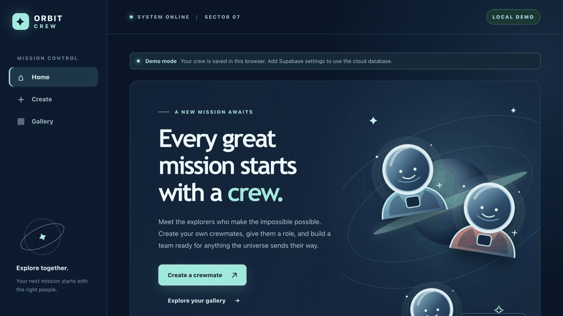

# Web Development Project 7 — Orbit Crew

Submitted by: **Yudhiishbala V Senthilkumar**

**Orbit Crew** is a space-themed Crewmates app. Create explorers, choose their roles and specialties, and assemble a team for your next mission.

## Required Features

The following required functionality is complete:

- [x] A create page lets users name a crewmate and choose attributes by clicking options.
- [x] A gallery displays all created crewmates, newest first.
- [x] Each gallery card has an edit link. The edit page loads current values, and saved changes appear on the form and in the gallery.
- [x] The edit page can delete a crewmate; the deleted crewmate disappears from the gallery.
- [x] Every crewmate has a unique `/crew/:id` detail URL with a mission note, specialty, suit color, joined date, and an edit link.

## Stretch Features

- [x] A role category limits the specialty choices to that role.
- [x] The gallery shows total crew size and counts by role.
- [x] Mission readiness changes with crew size and role diversity. Four or more members covering all four roles score 100%.

## Video Walkthrough

The GIF walks through creating, viewing, editing, and deleting crewmates:



## Run Locally

```bash
npm install
npm run dev
```

Open the local URL printed by Vite. With no Supabase settings, the app runs in **Demo mode** and saves crewmates in this browser's localStorage. The demo crew is separate from any Supabase crew.

## Connect Supabase

1. Create a Supabase project and enable [anonymous sign-ins](https://supabase.com/docs/guides/auth/auth-anonymous) in its Auth settings.
2. Run [`supabase/migrations/20261104000000_create_crewmates.sql`](supabase/migrations/20261104000000_create_crewmates.sql) in the Supabase SQL Editor. It creates the table, constraints, timestamps, and row-level security policies.
3. Copy `.env.example` to `.env` and fill in the project URL and **publishable** key:

   ```env
   VITE_SUPABASE_URL=https://YOUR_PROJECT_REF.supabase.co
   VITE_SUPABASE_PUBLISHABLE_KEY=YOUR_PUBLISHABLE_KEY
   ```

4. Restart `npm run dev`. The status badge should read **SUPABASE LIVE**. A connection error stays visible with a retry button; the app will not silently switch to Demo mode.

Never put a service-role or secret key in a `VITE_` variable. The app uses `@supabase/supabase-js` for all cloud CRUD operations. Anonymous accounts keep each browser's crew separate through [row-level security](https://supabase.com/docs/guides/database/postgres/row-level-security). Clearing browser data or using another browser loses access to that anonymous account's crew.

## Tests and Build

```bash
npm test
npm run build
```

Tests cover validation, role restrictions, browser storage, Supabase request handling, all main UI flows, failed requests, and route navigation. The app's cloud path needs a configured Supabase project for an end-to-end live check. For production hosting, configure a single-page-app fallback to `index.html` so direct `/crew/:id` links load correctly.

## Submission Notes

- [x] Feature checklist and GIF walkthrough are included.
- [x] Work is committed in milestones locally.
- [ ] Create a **private** GitHub repository and push this project.
- [ ] Add `codepathreview` as a collaborator on that private repository.
- [ ] Submit the repository through the course portal.

The private GitHub repository and course submission require account access; they are not part of the local app setup.
